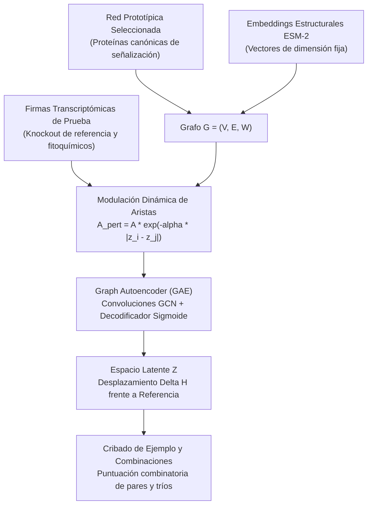

# 🧬 GNN Natural Products Pharmacology Suite (FaCENA - UNNE)
### Versión 1.0 — Prueba de Concepto Inicial y Entorno Pedagógico de Beca

[](https://www.python.org/downloads/)
[](https://pytorch-geometric.readthedocs.io/)
[](https://opensource.org/licenses/MIT)
[](https://www.unne.edu.ar/)

> **Proyecto Acreditado:** *Integración de la Bioinformática y el Modelado Molecular para entender el mecanismo de acción de plantas etnomedicinales*  
> **Código de Proyecto:** PI 21F012 (SeGCyT-UNNE)  
> **Lugar de Trabajo:** Laboratorio de Estructura Molecular y Propiedades (LEMyP), Facultad de Ciencias Exactas y Naturales y Agrimensura (FaCENA) — Universidad Nacional del Nordeste (UNNE), Corrientes, Argentina.  
> **Directores:** Dr. Emilio Luis Angelina & Dirección de Beca FaCENA UNNE  
> **Investigador / Desarrollo:** Ernesto Rafael Perez  
> **Becaria de Investigación:** Anahí Ayelén Espinoza (Profesorado en Matemática)  

---

## 📌 1. Declaración de Alcance y Transparencia Metodológica

Esta **Versión 1.0** constituye la **prueba de concepto inicial (PoC)** y el entorno formativo diseñado para el inicio del plan de beca de investigación:

* **Conjunto de Proteínas Acotado y Canónico:**  
  Para esta etapa formativa, el pipeline no procesa el proteoma completo. Modela una red prototípica de **proteínas clave seleccionadas en cascadas de transducción de señales** (como *BRAF*, *RAF1*, *MAP2K1*, *MAPK1*, *TP53*, *MDM2*, entre otras representativas).
* **Datos de Referencia y Contingencia Determinista (Offline-Ready):**  
  Para que la becaria pueda estudiar, ejecutar y depurar los algoritmos matemáticos en cualquier equipo o en Google Colab sin depender de conexiones inestables o saturación de APIs externas, los módulos incorporan **datos estructurados de contingencia (canónicos/hardcodeados)**. Esto garantiza que la construcción del grafo y la extracción de características funcionen siempre de forma determinista y predecible.
* **Evaluación de Sinergia Prototípica:**  
  La cuantificación combinatoria de combinaciones de fitoquímicos (Curcumina, Resveratrol, Quercetina, EGCG, Berberina) se implementa como un **ejemplo ilustrativo de base**, evaluando el exceso de similitud coseno en el espacio latente del autoencoder frente a una condición de referencia.

---

## 🔬 2. Flujo Metodológico de la Prueba de Concepto



---

## 📑 3. Contenido del Repositorio

* **`notebooks/`**: Cuadernos interactivos diseñados para el aprendizaje paso a paso:
  * `00_Pipeline_Maestro_GNN_Farmacologia_Completo.ipynb`: Flujo unificado All-in-One.
  * `01_Plan_Beca_FaCENA_Ingesta_PPI_y_Embeddings_ESM2.ipynb`: Construcción del grafo prototipo y embeddings.
  * `02_Plan_Beca_FaCENA_Integracion_CMap_y_Perturbaciones.ipynb`: Modulación dinámica con firmas de prueba.
  * `03_Plan_Beca_FaCENA_Modelo_Graph_Autoencoder_GAE.ipynb`: Entrenamiento del autoencoder de grafos.
  * `04_Plan_Beca_FaCENA_Cribado_Virtual_y_Optimizacion_Sinergias.ipynb`: Evaluación combinatoria de combinaciones.
* **`src/gnn_pharmacology/`**: Módulos Python básicos que encapsulan la lógica de la prueba de concepto (`ppi_loader`, `protein_embedder`, `cmap_modulator`, `gae_model`, `synergy_optimizer`).
* **`docs/`**: Guías explicativas teóricas y pedagógicas para la defensa y redacción del plan de beca.
* **`data/`**: Tablas canónicas de muestra para ejecución offline.
* **`tests/`**: Pruebas unitarias básicas para verificar la integridad del código.

---

## 🛠️ 4. Instalación y Uso Rápido

```bash
# 1. Clonar el repositorio
git clone https://github.com/iasaludlemyp/gnn_pharmacology_facena_suite_v1.git
cd gnn_pharmacology_facena_suite_v1

# 2. Instalar dependencias
pip install -r requirements.txt
pip install -e .

# 3. Correr pruebas de verificación
python -m pytest tests/
```

---

## 🔮 5. Trabajo Futuro y Líneas en Desarrollo

Como evolución natural de esta prueba de concepto inicial, el equipo de investigación se encuentra desarrollando versiones posteriores avanzadas que incorporan:
1. **Escalado a Vías Metabólicas y Módulos de Enfermedad Complejos:** Extensión del modelo hacia redes a gran escala que integran vías metabólicas y señalización celular en patologías de interés biomédico prioritario.
2. **Integración con Datos Experimentales y Clínicos Masivos:** Asimilación de bases de datos farmacológicas y transcriptómicas globales.
3. **Modelado Biofísico Estructural Complementario:** Incorporación de cribado molecular focalizado para la convalidación termodinámica de las dianas predichas.

*(Dichas mejoras forman parte del cronograma de investigación del proyecto y serán publicadas en versiones y repositorios sucesivos).*

---

## 📜 6. Licencia y Contacto

* **Licencia:** MIT License. Código de libre acceso para fines académicos y formativos.
* **Contacto:** `iasaludlemyp@gmail.com` | `beca.investigacion@facena.unne.edu.ar`
* **Institución:** Laboratorio de Estructura Molecular y Propiedades (LEMyP), FaCENA - UNNE.
