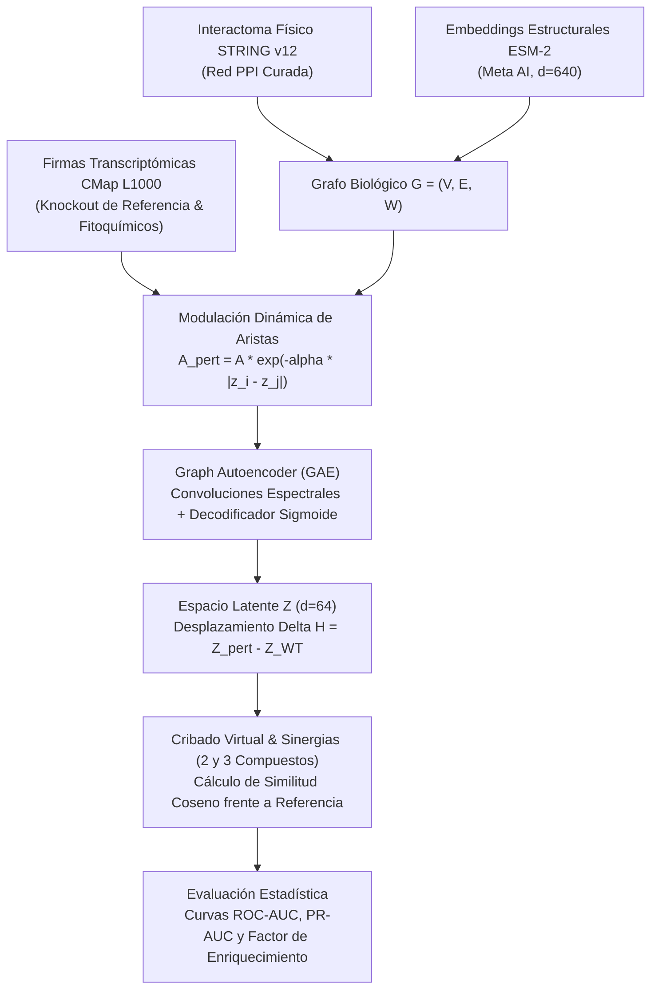

# 🧬 GNN Natural Products Pharmacology Suite (FaCENA - UNNE)
### Suite de Farmacología de Redes, Modelado de Grafos Neuronales y Etnomedicina — v1.0

[](https://www.python.org/downloads/)
[](https://pytorch-geometric.readthedocs.io/)
[](https://fastapi.tiangolo.com/)
[](https://opensource.org/licenses/MIT)
[](https://www.unne.edu.ar/)

> **Proyecto Acreditado:** *Integración de la Bioinformática y el Modelado Molecular para entender el mecanismo de acción de plantas etnomedicinales*  
> **Código de Proyecto:** PI 21F012 (SeGCyT-UNNE)  
> **Lugar de Trabajo:** Laboratorio de Estructura Molecular y Propiedades (LEMyP), Facultad de Ciencias Exactas y Naturales y Agrimensura (FaCENA) — Universidad Nacional del Nordeste (UNNE), Corrientes, Argentina.  
> **Directores:** Dr. Emilio Luis Angelina & Dirección de Beca FaCENA UNNE  
> **Investigador / Desarrollo:** Rafael "Rafa" Pérez  
> **Becaria de Investigación:** Anahí Ayelén Espinoza (Profesorado en Matemática)  

---

## 📌 1. Visión General y Fundamento

La presente suite computacional modela el mecanismo de acción y la sinergia farmacológica de **productos naturales y fitofármacos regionales** (Curcumina, Resveratrol, Quercetina, EGCG del Té Verde, Berberina) sobre el interactoma proteómico humano en patologías complejas (oncología y procesos inflamatorios).

El sistema integra de forma modular:
1. **Topología del Interactoma Físico:** Interacciones proteína-proteína (PPI) de alta confianza derivadas de **STRING v12.0** ($S \ge 700$).
2. **Embeddings de Lenguaje de Proteínas:** Vectores latentes de $d=640$ por nodo generados mediante el modelo transformer **ESM-2** (*facebook/esm2_t30_150M_UR50D*, Meta AI).
3. **Perturbaciones Transcripcionales Dinámicas:** Modulación biofísica de las aristas del grafo a partir de firmas de expresión génica diferencial **CMap L1000** ($z$-scores).
4. **Graph Autoencoder (GAE):** Red convolucional de grafos (GCN) que proyecta la perturbación a un espacio latente $Z \in \mathbb{R}^{N \times 64}$.
5. **Cribado Virtual y Sinergias Multitarget:** Cuantificación del vector de desplazamiento latente ($\Delta H$), optimización combinatoria de pares y tríos, y validación mediante curvas **ROC-AUC** y **Precision-Recall (PR-AUC)**.

---

## 📐 2. Flujo Metodológico



---

## 📑 3. Estructura del Repositorio

```text
├── app/
│   ├── __init__.py
│   └── main.py                     # API RESTful en FastAPI con visualizador interactivo
├── data/
│   ├── README.md                   # Documentación de esquemas y contingencia
│   ├── string_v12_ppi_canonical_sample.csv
│   └── cmap_l1000_phytochemical_signatures_sample.csv
├── docs/
│   ├── GUIA_EXPLICATIVA_MAESTRA_SISTEMA_BECA_ANAHI.md
│   ├── GUIA_TEORICA_Y_FUNDAMENTOS_BECARIA_ANAHI.md
│   └── PLANTILLA_INFORME_BECA_FACENA_ANAHI.md
├── notebooks/
│   ├── 00_Pipeline_Maestro_GNN_Farmacologia_Completo.ipynb       # Cuaderno unificado All-in-One
│   ├── 01_Plan_Beca_FaCENA_Ingesta_PPI_y_Embeddings_ESM2.ipynb   # Ingesta PPI y ESM-2
│   ├── 02_Plan_Beca_FaCENA_Integracion_CMap_y_Perturbaciones.ipynb # Firmas CMap L1000
│   ├── 03_Plan_Beca_FaCENA_Modelo_Graph_Autoencoder_GAE.ipynb    # Entrenamiento GAE
│   └── 04_Plan_Beca_FaCENA_Cribado_Virtual_y_Optimizacion_Sinergias.ipynb # Sinergias
├── src/
│   └── gnn_pharmacology/
│       ├── __init__.py
│       ├── ppi_loader.py           # Conexión STRING API v12 con contingencia local
│       ├── protein_embedder.py     # Generación de embeddings ESM-2
│       ├── cmap_modulator.py       # Modulación de adyacencia dinámica
│       ├── gae_model.py            # Arquitectura Graph Autoencoder (GCN)
│       └── synergy_optimizer.py    # Algoritmos combinatorios de sinergia
├── tests/
│   ├── test_ppi_loader.py
│   ├── test_protein_embedder.py
│   ├── test_cmap_modulator.py
│   ├── test_gae_model.py
│   └── test_synergy_optimizer.py
├── pyproject.toml                  # Metadatos del paquete y dependencias
├── requirements.txt                # Dependencias pip
├── setup.sh                        # Script automatizado de instalación y pruebas
└── README.md
```

---

## 🚀 4. Instalación y Uso Local

### 1. Clonar el repositorio y preparar el entorno
```bash
git clone https://github.com/iasaludlemyp/gnn-pharmacology-v1-becaria.git
cd gnn-pharmacology-v1-becaria

# Crear y activar entorno virtual
python -m venv venv

# En Windows (PowerShell):
.\venv\Scripts\Activate.ps1

# En Linux / macOS:
source venv/bin/activate
```

### 2. Instalar dependencias
```bash
pip install -r requirements.txt
pip install -e .
```

### 3. Ejecutar suite de pruebas unitarias
```bash
pytest -v
```

### 4. Lanzar API interactiva (FastAPI)
```bash
uvicorn app.main:app --reload
```
Acceder a la documentación Swagger interactiva en: [http://localhost:8000/docs](http://localhost:8000/docs)

---

## ☁️ 5. Ejecución en Google Colab

Todos los cuadernos de la carpeta `notebooks/` están adaptados para ejecución directa en la nube:
1. Subir cualquiera de los cuadernos de `notebooks/` a [Google Colab](https://colab.research.google.com/).
2. La Celda 0 de cada cuaderno incluye la instalación automatizada de paquetes (`pip install torch torch-geometric networkx ...`).
3. En caso de operar sin conexión a internet, los módulos cuentan con mecanismos de contingencia (*self-contained fallbacks*) que garantizan la ejecución determinista del pipeline pedagógico.

---

## 🎓 6. Marco Pedagógico e Institucional

Este repositorio forma parte del plan de formación de recursos humanos de la **FaCENA - UNNE** y la **SeGCyT**. Establece un puente formal entre la **Matemática Pura** (teoría espectral de grafos, transformaciones bilineales sobre el Laplaciano, optimización convexa) y la **Bioinformática Estructural y Farmacológica**:

| Concepto Biológico | Estructura Matemática | Implementación en Código |
| :--- | :--- | :--- |
| **Proteína / Gen** | Nodo $v_i \in V$ | `gene_to_idx[g]` |
| **Interacción Física** | Arista ponderada $(v_i, v_j) \in E$ | Matriz de Adyacencia $A \in \mathbb{R}^{N \times N}$ |
| **Secuencia Aminoacídica** | Vector continuo en $\mathbb{R}^d$ | ESM-2 Embedding $X \in \mathbb{R}^{N \times 640}$ |
| **Firma CMap L1000** | Campo escalar discreto $\mathbf{z} \in \mathbb{R}^N$ | Vector $z$ ($z_i > 0$ sobreexp., $z_i < 0$ inhib.) |
| **Convolución GCN** | Normalización simétrica del Laplaciano | $\hat{A} = \tilde{D}^{-1/2} \tilde{A} \tilde{D}^{-1/2}$ |
| **Decodificador Latente** | Producto interno sigmoidal | $\hat{A}_{ij} = \sigma(\mathbf{z}_i \cdot \mathbf{z}_j^T)$ |
| **Sinergia Farmacológica** | Exceso sobre agente individual más potente | Score HSA & Similitud Coseno de $\Delta H$ |

---

## 📜 7. Licencia y Contacto

* **Licencia:** MIT License. Código abierto para fines académicos y de investigación.
* **Institución:** Laboratorio de Estructura Molecular y Propiedades (LEMyP), FaCENA - UNNE.
* **Contacto Institucional:** `iasaludlemyp@gmail.com` | `beca.investigacion@facena.unne.edu.ar`
